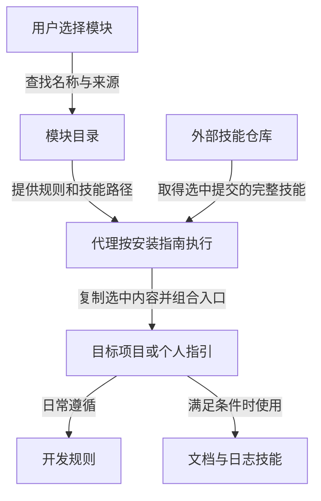

# 总览与分层

本项目用于跨项目、跨 agent 管理开发规则和技能，作为真源集中维护可组合的内容、版本与宿主适配约定。用户也可选择自己的 fork 为真源。用户把仓库链接和模块选择交给代理，由代理安装到指定项目或个人环境。当前是模块目录与可执行的文字流程，没有后台安装服务；实际读取与安装由代理完成。

## 组成与协作

`catalog/` 是模块组成、外部来源与版本策略目录；`SYNC.md` 规定比对和汇回流程，`adapters/` 管理加载差异，`tools/` 提供只读本地偏离检查；`INSTALL.md` 说明选择、获取、合并、验证及后续维护；`rules/` 和 `skills/` 是本仓库的实际产品。清晰沟通模块只登记上游路径，源码仍由外部仓库维护。根 AGENTS.md 用于维护本仓库，不复制给目标项目。

## 使用与维护权限

所有者及获授写权限的维护者可授权 agent 修改源仓库；其他人可以直接安装并升级到本仓库的新版本。需要维护自己的通用内容时，使用自己的 fork 为真源。源仓库访问权限与任务授权分别判断：可推送不代表每次开发都应推送。项目安装升级、源仓库发布和 fork 迁移分别记录完成状态，避免一次修改未经确认就影响多个项目。详细步骤见 [同步与源仓库维护](../../SYNC.md)。

## 核心选择

模块把有关联的规则和技能作为一个选择：例如选择架构功能实现，就同时获得持续维护约定和具体写作流程。文件仍各自独立，目标入口组合加载，避免复制粘贴成一份失去来源的大规则。代价是需要保持路径与入口一致，并记录版本和本地修改。项目副本不具有独立内容权威；通用改进回真源，项目约定另存。适配只改变有依据的格式和加载方式，不借机改写行为。

安装默认将规则、技能和触发约定保存在项目；宿主目录决定如何发现，不决定项目规则的归属。多个代理尽量共享维护来源，只增加必要加载入口；个人或账号执行副本属于受限制环境的替代方式，不能自动扩大作用域。具体边界见 [安装范围设计](../设计/project-first-installation.md)。

目录可登记第三方资源，但不自动取得信任。代理根据用户选择检查实际来源与内容，再安装；推荐候选不等于安装授权。安装记录使更新和移除能够辨别哪些文件由本次安装管理，避免覆盖已有工作。

常驻规则保留目标与触发条件，详细流程按需读取。通用规则要求专业维护质量及适用标准，具体设计见 [工程依据](../设计/engineering-principles.md)。文档模块与日志模块独立：前者说明当前版本，后者记录变化；即使只装其中一个也保持这条边界。

## 文档与验证

[功能全貌](01-功能全貌.md)列出当前能力。架构文档保留现行设计理由，不承担按日期追加的历史记录；历史见 [开发日志](../开发日志/CHANGELOG.md)，模块设计依据见 [设计记录](../设计/module-installation-design.md)。

当前模块通过文件和指令分发，不保证模型遵循，不替代测试与权限控制。安装、技能可加载和默认触发分别验证；本项目没有声称已在所有客户端完成安装测试。实际证据与限制见 [验证记录](../评测/evaluation.md)。

本地检查器比较安装结果与已记录哈希，源码版本新旧由同步流程另行核对。没有锁记录的旧副本先追溯来源，不能用当前文件哈希证明来源一致。这样区分“装后被改过”和“上游已有新版”，避免错误覆盖。详见 [唯一真源设计](../设计/single-source-maintenance.md)。

## 语言与分发

使用指南提供中英文入口，清单以统一 ID 管理模块并保留中英文名称检索。rules/、skills/ 及技能运行资源只分发一套英文指令，输出遵循用户语言；中文对照留在 doc/中文对照供维护者阅读，不随技能加载。两种语言共享来源与版本，避免为翻译维护两套技能。现有路径与历史材料保留，具体约定见 [双语维护](../中文对照/README.md)。

首次安装优先核实通用 `.agents/skills/` 和 `.agent-rules/`，不能仅按宿主品牌选择目录。外部清晰沟通首次安装或明确升级时解析 main，再把实际提交锁入项目记录；重装和新增代理复用锁定提交。来源策略统一与实际安装版本一致是不同要求，跨项目版本一致由授权同步完成。
